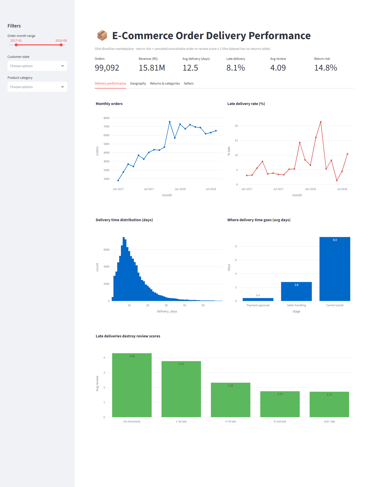
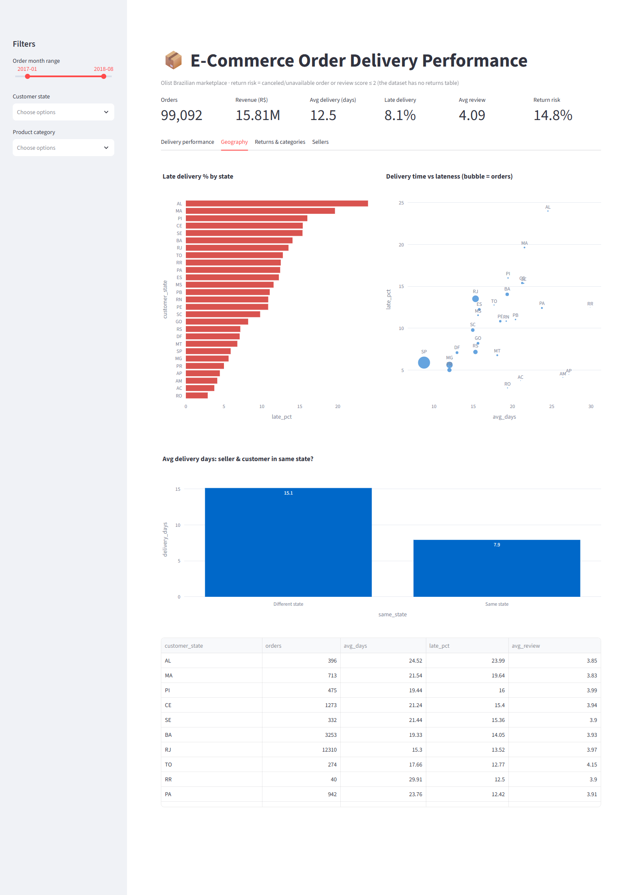
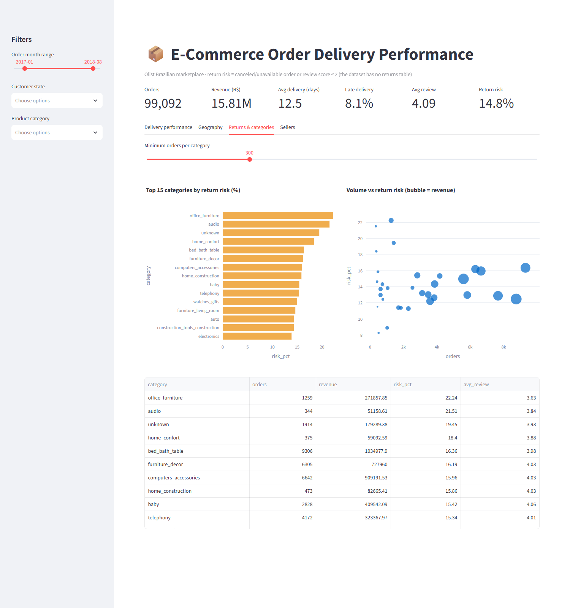
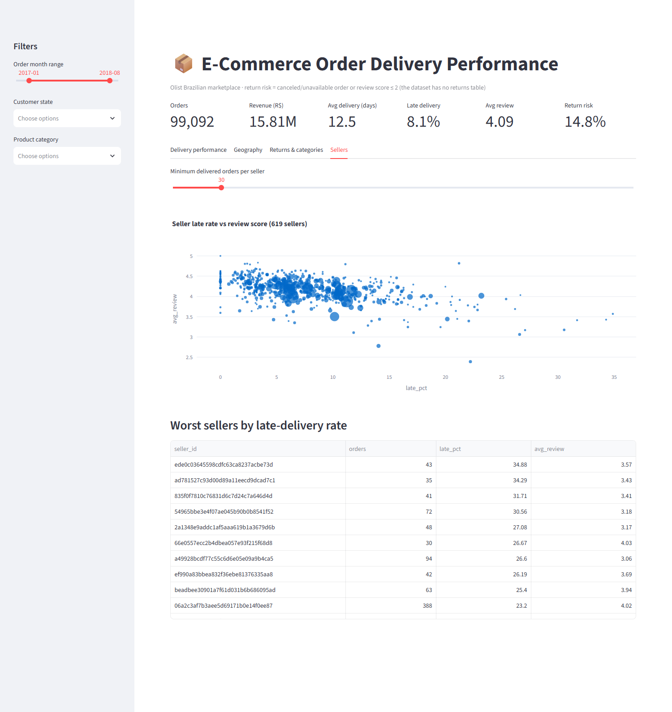
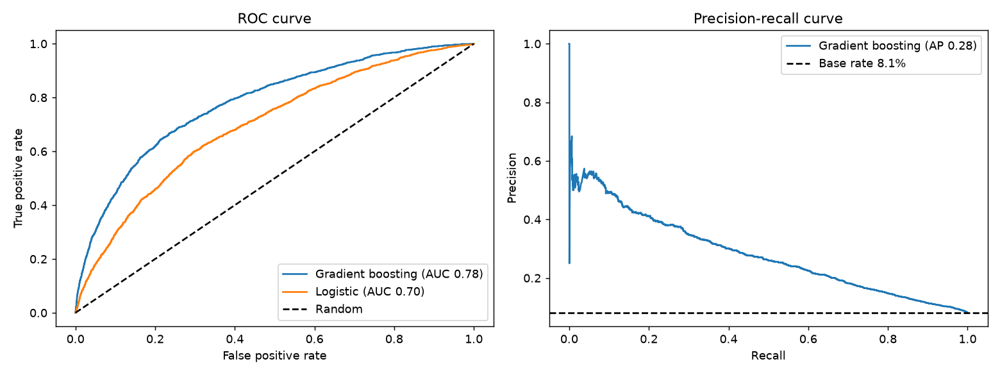
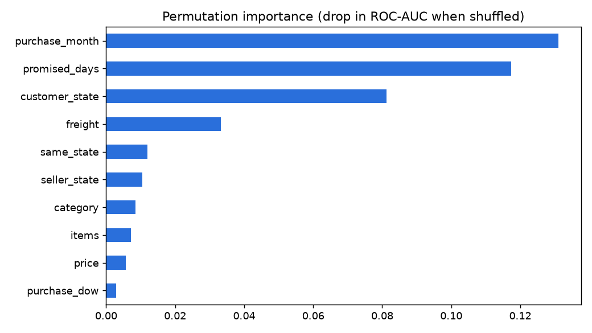

# 📦 E-Commerce Order Fulfillment & Returns Analytics

**Late deliveries are the single biggest driver of bad reviews on a Brazilian marketplace – and they're concentrated in a few regions, sellers and categories.**
End-to-end analysis of ~99K Olist orders (2016–2018) using **SQL · Python · Jupyter · Streamlit · scikit-learn**, with an interactive dashboard,
a late-delivery prediction model and actionable recommendations.



## 🔎 Headline findings
| | |
|---|---|
| **8.1%** of orders arrive late | but they cause most low reviews: avg score **4.29 → 3.77 → ~1.7** (on time → 1–3 days late → 8+ days late) |
| **9.3 of 12.6 days** is carrier transit | seller handling is 2.8 days, payment approval 0.4 |
| **Northeast states are worst** | AL 24%, MA 20%, PI 16%, CE 15% late – vs ~6% in São Paulo |
| **Same-state orders arrive ~2× faster** | 7.9 vs 15.1 days (71% of orders ship from SP sellers) |
| **Return risk 14.8%** | highest: office furniture 22%, audio 21%, home comfort 18% |
| **Only 3.1% of customers reorder** | a bad first delivery is rarely recovered |

> **Note on "returns":** Olist has no returns table. *Return risk* is proxied as an order that was **canceled/unavailable** or got a **review score ≤ 2**.

## 💡 Recommendations
1. Set realistic delivery promises for northeast states, or add regional fulfillment hubs.
2. Notify customers *before* the promised date is missed – the review penalty starts at 1–3 days late.
3. Audit quality/packaging in high-risk categories (office furniture, audio).
4. Put chronically late sellers on improvement plans (`outputs/tables/seller_scorecard.csv`).
5. Use the late-delivery model to flag risky orders at purchase time for proactive handling.

## 🖥️ Interactive dashboard (Streamlit)
Filters for month range, state and category; KPI cards; 4 tabs. Run locally: `streamlit run dashboard/app.py`.

| Delivery performance | Geography |
|---|---|
|  |  |

| Returns & categories | Sellers |
|---|---|
|  |  |

## 🗄️ SQL analysis (`sql/`)
Raw CSVs are loaded into SQLite (`python/load_db.py`), a reusable `order_facts` view is built (`sql/00_views.sql`),
and 8 queries use CTEs, window functions (`LAG`, `RANK`, `ROW_NUMBER`), multi-table joins and conditional aggregation.
Results are saved to `outputs/sql/`.

| Query | Question |
|---|---|
| 01_kpis | Headline KPIs |
| 02_monthly_trend | Orders/revenue and month-over-month growth |
| 03_late_by_state | Delivery performance by state |
| 04_delivery_stages | Where does delivery time go? |
| 05_review_vs_delay | How much does lateness hurt reviews? |
| 06_category_return_risk | Return risk by product category |
| 07_seller_scorecard | Worst sellers by late rate (ranked) |
| 08_repeat_customers | Customer retention |

## 🐍 Python analysis & notebook
- `python/analysis.py` – cleaning, joins, feature engineering, KPIs, summary tables and charts (`outputs/`).
- `notebooks/01_eda_order_fulfillment.ipynb` – fully executed, narrated walkthrough: data-quality checks, join logic
  (with a no-duplication assertion), EDA, findings. GitHub renders it directly.

<p>
  
</p>

## 🤖 Late-delivery prediction (`python/predict_late_delivery.py`)
Predicts whether an order will arrive late using **only information known at purchase time** (states, category, price, freight,
promised delivery window, purchase month/weekday) – no leakage from shipping timestamps.

| Validation | Model | ROC-AUC | PR-AUC | Precision (top 20% risk) | Recall (top 20% risk) | Base late rate |
|---|---|---|---|---|---|---|
| Random 75/25 | Gradient boosting | 0.78 | 0.28 | 23.5% | 57.9% | 8.1% |
| **Out-of-time** (train < May 2018, test May–Aug 2018) | Gradient boosting | **0.72** | 0.13 | 14.1% | 45.4% | 6.2% |
| Out-of-time | Logistic regression | 0.70 | 0.12 | 11.9% | 38.2% | 6.2% |

**Honest reading:** the out-of-time score is the realistic one – the random split lets the model learn month-specific disruptions
(e.g. the Feb–Mar 2018 spike). Flagging the riskiest 20% of orders catches ~45% of late ones at ~2.3× the base rate: useful for
prioritizing proactive communication, but not a precise predictor. Lateness is driven partly by factors not in the data
(carrier capacity, weather, distance). Biggest drivers: purchase month, promised delivery window, customer state, freight.

<p>
 
</p>

## 📊 Power BI assets (`powerbi/`)
A star-schema dataset (`fact_orders` + date/state/category/seller dimensions), 30+ DAX measures (`measures.dax`),
a theme (`theme.json`) and a page-by-page build guide (`BUILD_GUIDE.md`) for a 5-page Power BI report.
*These are ready-to-use build assets – the `.pbix` report itself is not included; the Streamlit app above is the finished dashboard.*

## 📁 Project structure
```
.
├── data/raw/                 # Olist CSVs (not committed – see "Run it")
├── python/                   # analysis.py, load_db.py, run_sql.py, predict_late_delivery.py,
│                             # prepare_powerbi_data.py, take_screenshots.py
├── sql/                      # order_facts view + 8 analysis queries
├── notebooks/                # narrated EDA notebook
├── dashboard/                # Streamlit app + its data
├── powerbi/                  # star-schema data, DAX, theme, build guide
├── outputs/{figures,tables,sql}/
├── documentation/            # data dictionary, methodology, dashboard screenshots
├── requirements.txt
└── LICENSE
```

## ▶️ Run it
```bash
pip install -r requirements.txt
# download the Olist CSVs into data/raw/  (Kaggle: "Brazilian E-Commerce Public Dataset by Olist")
python python/load_db.py && python python/run_sql.py   # SQL layer -> outputs/sql/
python python/analysis.py                              # Python layer -> outputs/, dashboard data
python python/predict_late_delivery.py                 # model -> outputs/
streamlit run dashboard/app.py                         # interactive dashboard
```
More detail: [`documentation/METHODOLOGY.md`](documentation/METHODOLOGY.md) · [`documentation/DATA_DICTIONARY.md`](documentation/DATA_DICTIONARY.md)

## 🛠️ Tools
Python (pandas, scikit-learn, matplotlib, seaborn, Plotly) · SQL (SQLite) · Streamlit · Jupyter · Power BI (assets) · Git

## ⚠️ Limitations
No true returns data (proxy used); review scores are self-selected; 2016 and late-2018 data are sparse; the model can't see
carrier capacity, weather or shipping distance.

## 📜 License & data
Code: MIT (see `LICENSE`). Data: Olist public dataset on Kaggle, CC BY-NC-SA 4.0 – not redistributed here.
