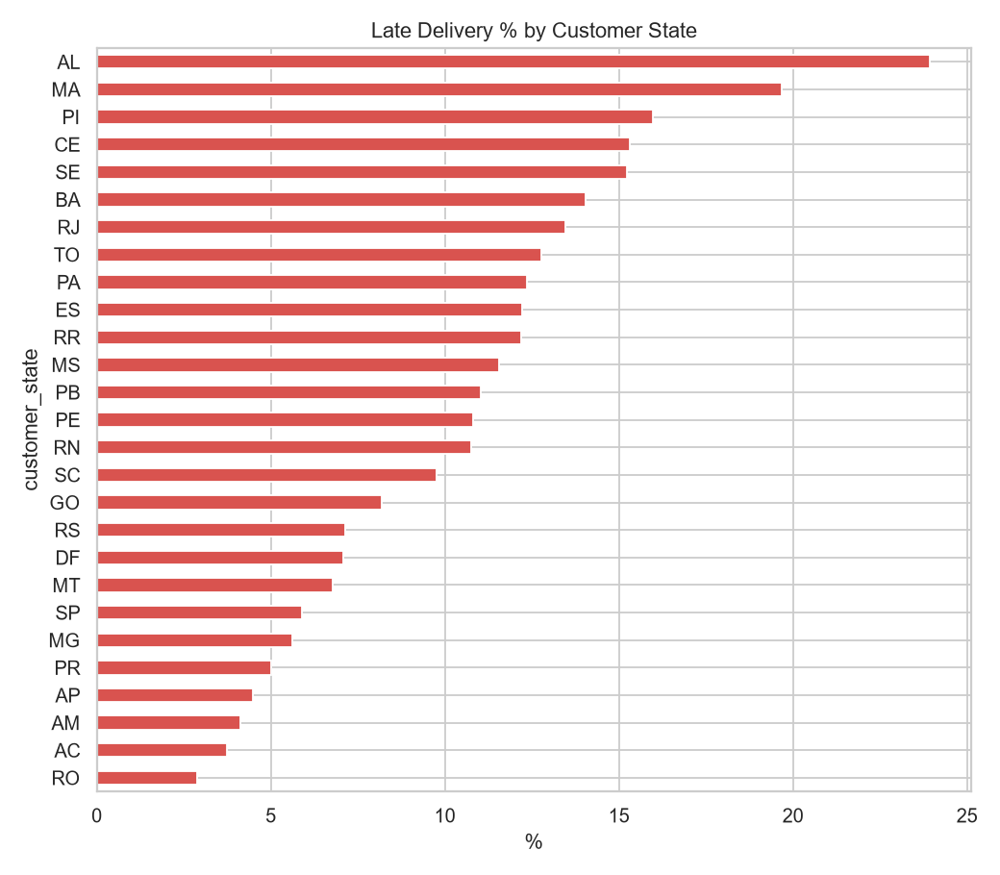
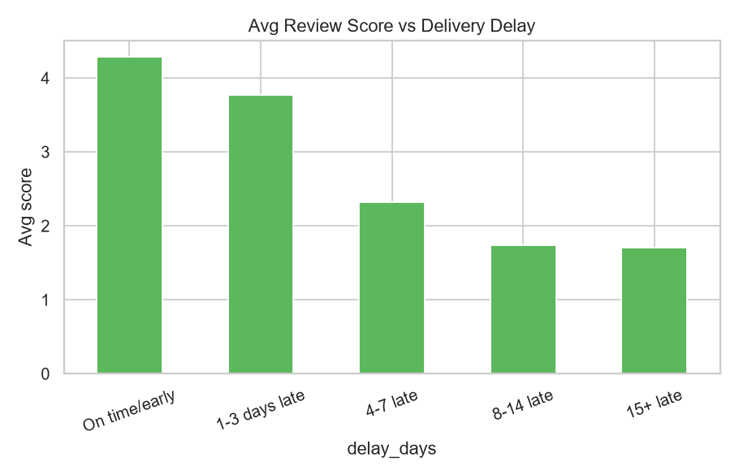
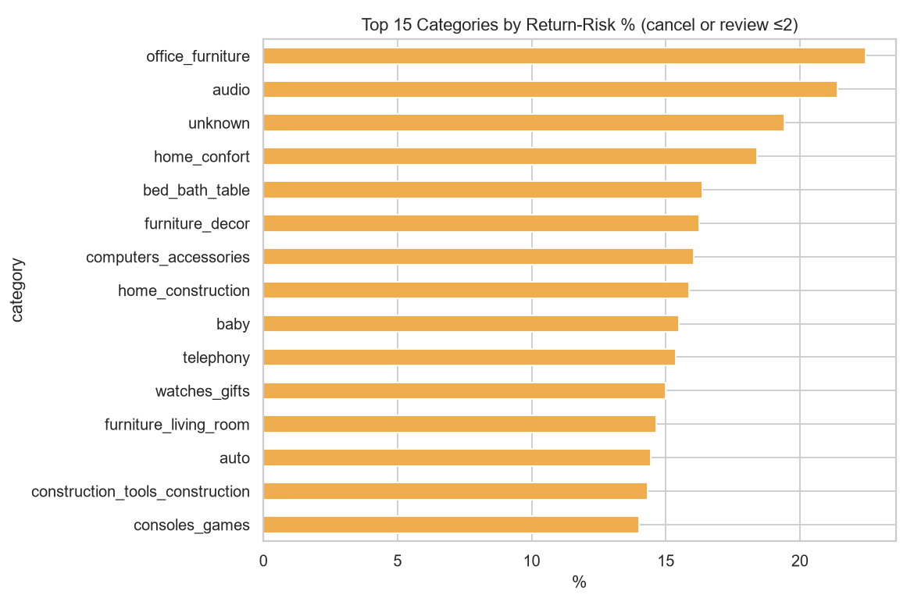

# E-Commerce Order Fulfillment & Returns Analytics

Analysis of ~99K orders from the Olist Brazilian e-commerce marketplace (2016–2018) to understand
**delivery performance, fulfillment bottlenecks and return risk**, and how they drive customer satisfaction.

## Business questions
1. How fast and how reliable is delivery? Where are orders late?
2. Which regions, sellers and product categories cause the most problems?
3. How much does late delivery hurt customer reviews?
4. Which categories carry the highest return risk?

> **Note on "returns":** Olist has no returns table. Return risk is proxied as an order that was
> **canceled/unavailable** or received a **review score ≤ 2**.

## Key results
| KPI | Value |
|---|---|
| Total orders | 99,441 |
| Revenue (non-canceled) | R$ 15.87M |
| Avg order value | R$ 160.99 |
| Avg / median delivery time | 12.6 / 10.2 days |
| Late delivery rate | 8.1% |
| Cancellation rate | 1.2% |
| Avg review score | 4.09 |
| Return-risk rate | 14.8% |

## Insights
- **Lateness destroys satisfaction:** average review is 4.29 on time, 3.77 for 1–3 days late, and ~1.7 when 8+ days late.
- **Geography drives delay:** northeast states (AL 23.9%, MA 19.7%, PI 16.0%, CE 15.3%, SE 15.2%) have the highest late rates,
  with ~21–25 day average delivery.
- **Same-state orders arrive ~2x faster** (8.0 vs 15.2 days) – seller distribution/regional fulfillment is a clear lever.
- **Highest return-risk categories:** office_furniture (22.5%), audio (21.4%), home_confort (18.4%), bed_bath_table (16.4%, high volume).

## SQL analysis (`sql/`)
Raw CSVs are loaded into SQLite (`python/load_db.py`), a reusable `order_facts` view is built (`sql/00_views.sql`),
and 8 queries answer the business questions using CTEs, window functions (`LAG`, `RANK`, `ROW_NUMBER`),
multi-table joins and conditional aggregation. Results are saved to `outputs/sql/`.

| Query | Question |
|---|---|
| 01_kpis | Headline KPIs |
| 02_monthly_trend | Orders/revenue and month-over-month growth |
| 03_late_by_state | Delivery performance by state |
| 04_delivery_stages | Where does delivery time go? |
| 05_review_vs_delay | How much does lateness hurt reviews? |
| 06_category_return_risk | Return-risk by product category |
| 07_seller_scorecard | Worst sellers by late rate (ranked) |
| 08_repeat_customers | Customer retention |

Extra SQL findings:
- **Carrier transit is the bottleneck:** of 12.6 days total, 9.3 are carrier transit, 2.8 seller handling, 0.4 payment approval.
- **Review penalty is steep:** 9% low reviews when on time, 19% at 1-3 days late, and 78% at 8+ days late.
- **Low retention:** only 3.1% of customers ordered more than once, so a bad first delivery is rarely recovered.

## Recommendations
- Set realistic estimated delivery dates for northeast states, or add regional fulfillment hubs.
- Proactively notify customers of delays before the promised date; the review penalty begins at 1–3 days late.
- Review quality/packaging/description for office furniture and audio categories.
- Put chronically late sellers (see `outputs/tables/seller_scorecard.csv`) on improvement plans.

## Project structure
```
.
├── data/
│   └── raw/                  # Olist CSVs (not committed; see Run it)
├── python/                   # all Python scripts
│   ├── analysis.py           # clean -> KPIs -> tables -> charts -> dashboard data
│   ├── load_db.py            # loads CSVs into SQLite (data/olist.db)
│   ├── run_sql.py            # runs the SQL queries, saves results
│   └── prepare_powerbi_data.py
├── sql/                      # order_facts view + 8 analysis queries
├── notebooks/                # narrated EDA notebook
├── dashboard/                # Streamlit app + its data
├── powerbi/                  # star-schema data, DAX, theme, build guide
├── outputs/
│   ├── figures/              # PNG charts
│   ├── tables/               # KPI + summary CSVs
│   └── sql/                  # SQL query results
├── documentation/
├── requirements.txt
└── README.md
```

## Run it
```bash
pip install -r requirements.txt
# place the Olist CSVs in data/raw/ (Kaggle: Brazilian E-Commerce Public Dataset by Olist)
python python/load_db.py && python python/run_sql.py   # SQL layer
python python/analysis.py                    # Python layer
```

## Charts




## Tools
Python · pandas · matplotlib · seaborn
